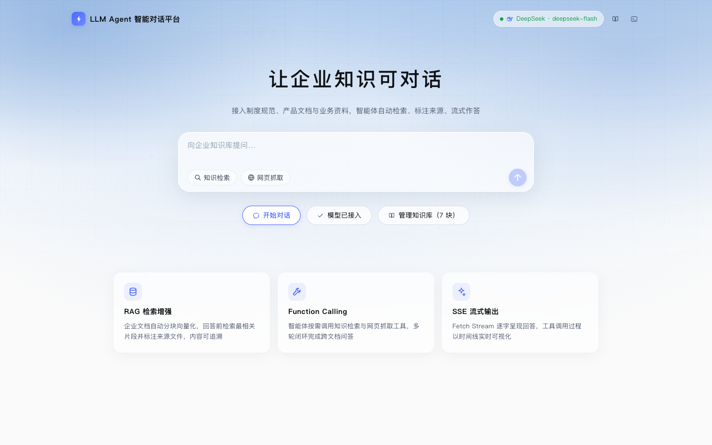
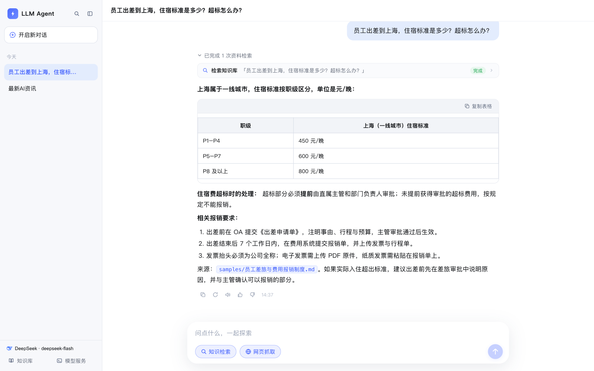
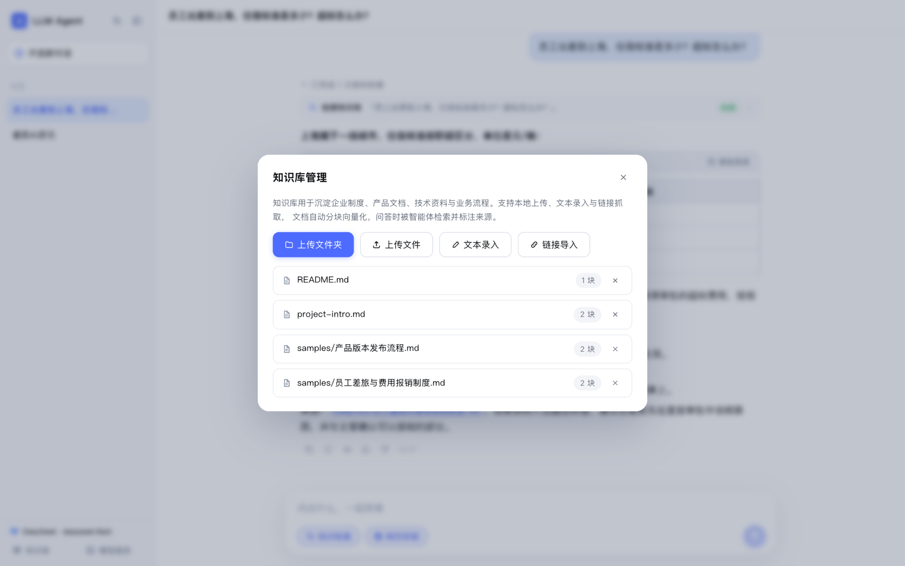
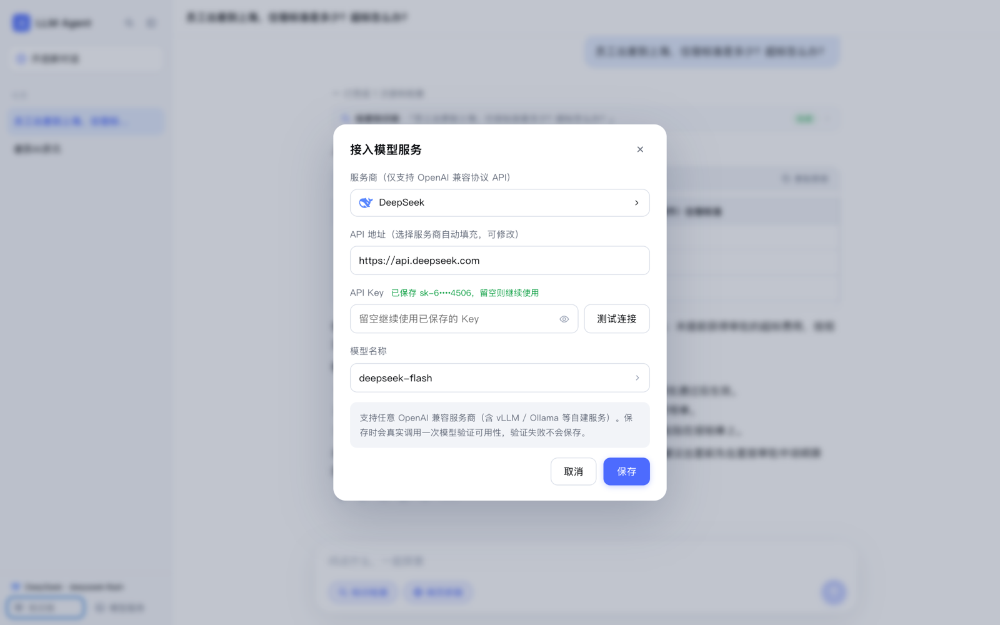
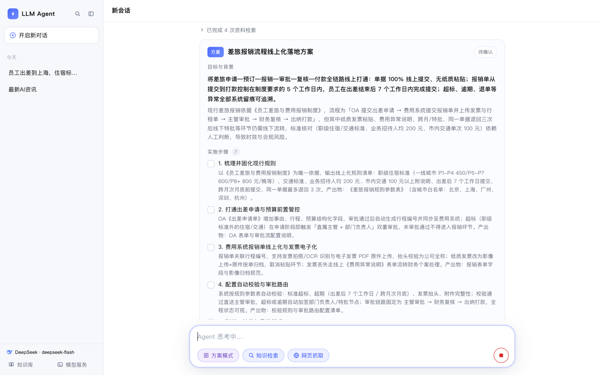
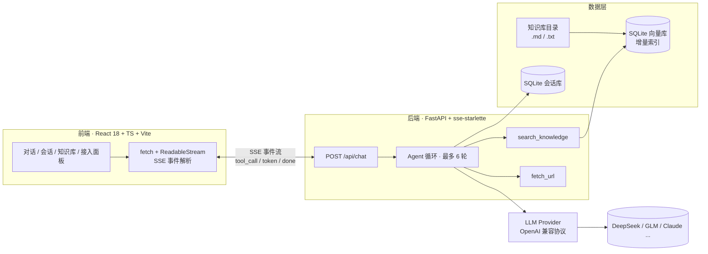
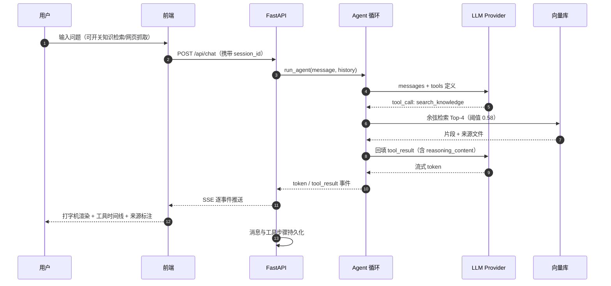
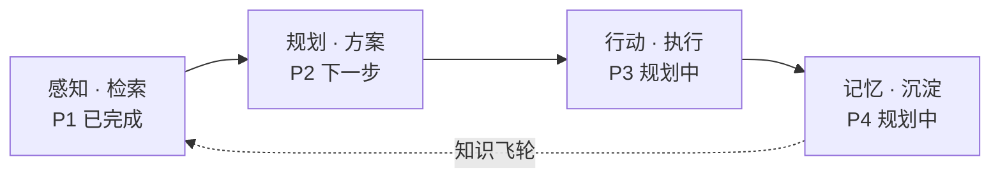

# LLM Agent 智能对话平台

**面向企业知识资产的 RAG 智能体**：知识库检索增强 + Function Calling 工具循环 + SSE 流式输出，
前端把 Agent 的工具调用过程与引用来源实时可视化。

[](LICENSE)
[](backend/requirements.txt)
[](frontend/package.json)
[](backend/requirements.txt)
[](backend/tests)

一句话：把分散在制度、产品文档、技术资料里的企业知识，变成**可检索、可溯源、可对话**的问答能力。

## 界面预览

| 首页 · 提问入口 | 对话 · 检索引用 + 工具步骤 |
|---|---|
|  |  |

| 知识库管理 · 文件/文件夹/文本/链接 | 模型接入 · 多服务商在线配置 |
|---|---|
|  |  |

| 方案模式 · 结构化方案卡片（P2 规划层） |
|---|
|  |

## 功能特性

| 能力 | 说明 |
|---|---|
| **RAG 检索增强** | 段落感知分块（500 字符 / 50 重叠）→ 本地 bge-small-zh 向量化 → 余弦 Top-4 检索，相似度阈值 0.58 防硬凑；回答标注来源文件，可回溯原文 |
| **方案模式（P2）** | 基于检索证据生成结构化方案卡片：目标 / 实施步骤 / **可溯源依据** / 风险与应对；方案需**人工确认**后才锁定，未确认不触发任何执行 |
| **Function Calling** | 智能体按需调用 `search_knowledge`（知识库检索）与 `fetch_url`（网页正文抓取），工具结果回填后继续推理，最多 6 轮闭环 |
| **SSE 流式输出** | 前端用 `fetch + ReadableStream` 自行解析 SSE（POST 场景，不用 EventSource），打字机式渲染 |
| **思考型模型兼容** | 适配 DeepSeek 等思考模型：工具调用轮回传 `reasoning_content`，避免 400 |
| **多服务商接入** | 在线配置 API 地址 / Key / 模型，内置 DeepSeek、智谱、通义千问、Moonshot、硅基流动、Mistral、Gemini、Claude、Ollama 预设；保存前真实调用验证 |
| **知识库四种录入** | 上传文件夹（保留目录结构）/ 上传文件 / 文本录入 / 链接批量抓取 |
| **富文本渲染** | 代码块（高亮/复制/下载）、表格（复制 CSV）、mermaid 流程图、LaTeX 公式、图片/音视频/文件卡片 |
| **消息操作** | 复制 / 重新生成 / 朗读（Edge 神经语音 + 播放声波动画）/ 点赞点踩（原因面板，持久化） |
| **会话管理** | 搜索、置顶、重命名、多选批量操作、空会话不落库 |
| **测试体系** | 37 个 pytest 用例（store / llm / rag / agent / api 五层）+ 真实链路端到端验证脚本 |

## 架构



一次提问的完整链路：



## 技术栈

| 层 | 选型 |
|---|---|
| 前端 | React 18 · TypeScript · Vite · react-markdown（KaTeX / highlight / mermaid 按需加载） |
| 后端 | FastAPI · uvicorn · httpx · sse-starlette |
| LLM | 任意 OpenAI 兼容协议（DeepSeek / GLM / 千问 / Kimi / Claude / Gemini / Ollama…） |
| Embedding | fastembed · BAAI/bge-small-zh-v1.5（本地 ONNX，零 Key 可跑，失败降级 hash 向量） |
| 存储 | SQLite（会话库 + 向量库） · 知识库为磁盘目录 |
| 测试 | pytest · FastAPI TestClient（monkeypatch 注入隔离状态，离线可跑） |

## 快速开始

```bash
# 后端
cd backend
python3 -m venv .venv && .venv/bin/pip install -r requirements.txt
LLM_PROVIDER=mock .venv/bin/python -m uvicorn app.main:app --port 8000

# 前端（另开终端）
cd frontend
npm install && npm run dev   # http://localhost:5173，已代理 /api 到 8000
```

接入真实 LLM：前端「接入模型服务」面板在线配置（保存到 `backend/data/runtime_config.json`，不入仓库），
也可用环境变量：

```bash
LLM_PROVIDER=openai \
LLM_BASE_URL=https://api.deepseek.com \
LLM_API_KEY=你的Key \
LLM_MODEL=deepseek-flash
```

## 配置

| 环境变量 | 默认值 | 说明 |
|---|---|---|
| `LLM_PROVIDER` | `openai` | `openai`（OpenAI 兼容）/ `mock`（离线演示） |
| `LLM_BASE_URL` / `LLM_API_KEY` / `LLM_MODEL` | GLM | OpenAI 兼容端点配置 |
| `EMBED_BACKEND` | `auto` | 优先 fastembed 本地模型，失败降级 hash 向量 |
| `KNOWLEDGE_DIR` | `backend/knowledge` | 知识库文档目录（.md/.txt，含子目录） |
| `RAG_TOP_K` | `4` | 检索返回条数 |
| `RAG_SCORE_THRESHOLD` | `0.58` | 检索相似度阈值，低于阈值不硬凑无关内容 |
| `MAX_TOOL_ROUNDS` | `6` | Agent 工具循环上限 |

## 知识库

知识库用于沉淀企业制度、产品文档、技术资料与业务流程，支持四种录入方式（均在前端「知识库管理」面板）：

| 方式 | 适用场景 | 落盘位置 |
|---|---|---|
| 上传文件夹 | 「项目知识库 / 产品文档 / 方案设计」等成体系的资产目录 | `uploads/<相对路径>`（结构保留） |
| 上传文件 | 单篇 `.md / .txt / .markdown` | `uploads/<文件名>` |
| 文本录入 | 短文档、FAQ、临时说明 | `uploads/<命名>.md` |
| 链接导入 | 外部文档页、制度页面（单次最多 10 条） | `uploads/网页抓取/<标题>.md` |

解析与检索规则：文档按段落合并分块（500 字符 / 50 重叠）→ 向量化 → SQLite 入库，
按 `相对路径:mtime` 做增量重建（改动的文件重入库、删除的文件清理残留块）；
**来源即相对路径**（如 `samples/员工差旅与费用报销制度.md`），回答引用可直接回溯到目录与原文。

> `backend/knowledge/personal/`（本地私有资料）与 `backend/data/`（向量库、运行时密钥）
> 默认被 `.gitignore` 排除，不会进入代码仓库。

## 接口

| 方法 | 路径 | 说明 |
|---|---|---|
| GET | `/api/health` | 服务状态、当前模型与知识库分块数（真实探测模型可用性，缓存 60s） |
| POST | `/api/chat` | SSE 对话（`message` / `session_id` / `force_retrieval` / `allow_fetch`） |
| GET | `/api/tts` | 文本转语音（Edge 神经语音 MP3，默认晓晓；失败自动降级浏览器 TTS） |
| POST | `/api/sessions` | 创建会话 |
| GET | `/api/sessions` | 会话列表（只返回有消息的会话，按置顶 + 最近更新排序） |
| GET | `/api/sessions/{id}` | 单个会话信息 |
| PATCH | `/api/sessions/{id}` | 重命名 / 置顶 |
| GET | `/api/sessions/{id}/messages` | 会话消息（含工具调用步骤与反馈） |
| DELETE | `/api/sessions/{id}` | 删除会话 |
| POST | `/api/messages/{id}/feedback` | 消息反馈（点赞 / 点踩 + 原因） |
| PATCH | `/api/messages/{id}/plan` | 方案状态流转（`draft` / `confirmed` / `rejected`），人工确认闸门 |
| GET/POST | `/api/config` | 读取 / 更新模型服务配置（Key 掩码回显，永不返回明文） |
| POST | `/api/config/test` | 真实调用一次模型验证配置（不落盘） |
| GET | `/api/knowledge` | 文档列表（含分块数） |
| POST | `/api/knowledge/upload` | 上传单个文件 |
| POST | `/api/knowledge/upload-dir` | 批量上传文件夹（保留相对目录结构） |
| POST | `/api/knowledge/text` | 文本录入 |
| POST | `/api/knowledge/url` | 链接批量导入 |
| DELETE | `/api/knowledge?source=` | 删除文档（文件 + 向量） |

## 测试

两层验证：**离线单测**（不需要模型 Key）与**真实链路端到端验证**（需要可用 Key）。

```bash
cd backend && .venv/bin/python -m pytest tests -q
```

| 模块 | 用例数 | 覆盖点 |
|---|---|---|
| `test_store.py` | 8 | 会话增删改查、置顶排序、标题自动生成、空会话过滤、反馈持久化、历史顺序 |
| `test_llm.py` | 10 | MockProvider 检索驱动行为、401/402/403/404/429 错误码映射、思考模型 `reasoning_content` 回传 |
| `test_rag.py` | 4 | 入库增量、已删文件脏块清理、delete_source |
| `test_agent.py` | 5 | RAG 检索、工具循环、阈值拒绝、未知工具、fetch_url 协议校验 |
| `test_api.py` | 10 | TestClient 集成：健康检查、Key 掩码、会话生命周期、SSE 全链路、反馈、TTS、文件夹上传（含路径穿越防护） |

真实链路（服务健康 → 配置连通 → 注入标记文档 → SSE 提问 → 断言检索命中 + 回答含标记 + 持久化 → 清理）：

```bash
cd backend && .venv/bin/python scripts/verify_real.py
```

## 部署

后端是 Python FastAPI（本地 ONNX embedding + SQLite 文件库 + 磁盘知识目录），
**不适合** Cloudflare Workers（无法跑 Python/ONNX/文件系统）或 Supabase（仅是数据库 BaaS，非应用运行时）。

### 方式一：Docker 单容器（推荐）

```bash
docker build -t llm-agent .
docker run -d -p 8000:8000 \
  -e LLM_BASE_URL=https://api.deepseek.com \
  -e LLM_API_KEY=你的Key \
  -e LLM_MODEL=deepseek-flash \
  -v ./knowledge:/app/backend/knowledge \
  -v ./data:/app/backend/data \
  llm-agent
```

多阶段构建：前端 `npm run build` 产物由 FastAPI 托管（SPA 回退已内置），
**单端口同时服务 API 与页面**；知识库与数据通过 volume 持久化。
适配 Render / Railway / Fly.io 等支持 Docker 的托管平台，或任意 VPS。

### 方式二：手动部署

```bash
npm --prefix frontend install && npm --prefix frontend run build
cd backend && .venv/bin/pip install -r requirements.txt
.venv/bin/python -m uvicorn app.main:app --host 0.0.0.0 --port 8000
```

前后端分离托管也可：前端 `dist/` 部署到 Vercel / Cloudflare Pages，后端单独部署并配置 CORS。

## 项目结构

```
llm-agent
├── backend/
│   ├── app/
│   │   ├── main.py        # FastAPI 入口：SSE 对话 / 知识库 / 配置 / TTS / 静态托管
│   │   ├── agent.py       # Agent 工具循环（最多 6 轮）+ 错误码人话映射
│   │   ├── llm.py         # OpenAI 兼容 Provider + MockProvider（思考模型 reasoning 支持）
│   │   ├── rag.py         # 分块 / 向量入库 / 余弦检索 / 增量索引
│   │   ├── embedder.py    # fastembed 本地 ONNX，失败降级 hash
│   │   ├── store.py       # SQLite 会话与消息持久化
│   │   ├── tools.py       # search_knowledge / fetch_url
│   │   └── config.py      # 环境变量与阈值
│   ├── knowledge/         # 知识库目录（samples/ 为示例文档）
│   ├── scripts/verify_real.py
│   └── tests/             # 37 个用例，离线可跑
├── frontend/
│   └── src/
│       ├── pages/         # Home / Chat
│       └── components/    # Sidebar / MessageBubble / MarkdownView / SettingsModal ...
├── docs/screenshots/      # README 演示截图
├── Dockerfile
└── LICENSE
```

## 路线图

当前已具备 **P1 感知层**（检索增强问答）。演进主线：**感知（检索）→ 规划（方案）→ 行动（执行）→ 记忆（沉淀）**。

| 阶段 | 目标 | 状态 |
|---|---|---|
| P1 感知 · 检索 | 文档入库、语义检索、来源追溯、工具调用可观测 | ✅ 已完成 |
| P2 规划 · 方案 | 基于检索证据生成结构化方案（背景/依据/步骤/风险），人工确认闸门 | 🚧 M1 已完成（方案卡片 + 确认闸门），M2 多方案对比待做 |
| P3 行动 · 执行 | 方案拆解为任务 DAG 并逐项执行，产出可校验交付物（diff 审批 + 沙箱） | 📋 规划中 |
| P4 记忆 · 沉淀 | 交付物归档回知识库，形成组织记忆飞轮 | 📋 规划中 |

完整设计（能力拆解、验收标准、模块映射、里程碑）见 **[docs/ROADMAP.md](docs/ROADMAP.md)**。



---

## 👨‍💻 作者 (Author)

- **Xxcool** - [GitHub (@Xxcool)](https://github.com/Xxcool) · [掘金技术主页](https://juejin.cn/user/4265760845468296/posts)

## 📄 开源许可 (License)

本项目遵循 [MIT License](LICENSE) 开源协议。
