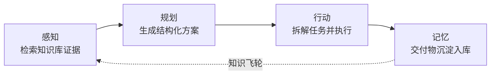

# 产品路线图（ROADMAP）

> 从「知识问答平台」到「知识驱动的交付闭环」——让智能体不止回答，还能**按方案把事情做完**。

> 范围说明：本页的「设计」「目标」「验收标准」含长期规划；里程碑完成状态仅对应各节「已落地」内容。当前已交付的是人工逐项执行的任务列表，没有 DAG 调度或运行中强制中断。现状以 README 和 ADR 为准。

## 一、定位

**一句话**：面向企业知识资产的智能体平台——基于知识库证据生成结构化方案，按方案拆解任务并驱动执行，交付物沉淀回知识库形成组织记忆飞轮。

传统 RAG 问答（Chat with KB）的天花板是「客服」：用户问，模型答，回答完流程就结束了。
本平台要补齐后面两段：**方案 → 执行 → 沉淀**。对应业界 `Agentic RAG` + `Plan-and-Execute` 范式，
智能体完成完整循环：

## 二、四阶段路线

| 阶段 | 名称 | 核心命题 | 状态 |
|---|---|---|---|
| P1 | 感知 · 检索 | 让智能体「查得准、说得有依据」 | ✅ 已完成 |
| P2 | 规划 · 方案 | 让输出从「一段话」变成「可确认的方案」 | ✅ M1 方案卡片 + 确认闸门；M2 多方案对比（已完成） |
| P3 | 行动 · 执行 | 让方案变成「跑得动的任务」 | ✅ M3 拆解/看板/文档交付；M4 代码交付 + diff 审批（已完成；命令执行默认关闭） |
| P4 | 记忆 · 沉淀 | 让每次交付都成为下次的资产 | ✅ M5 首增量已落地（归档/复盘/反馈重排/健康度/复用）；后续增强待做 |

---

### P1 · 感知（检索）✅ 已完成

**目标**：企业文档 → 可检索、可溯源的证据链。

| 能力 | 实现 |
|---|---|
| 知识入库 | 文件夹 / 文件 / 文本 / 链接四种录入；段落感知分块（500 字符分块，超长段落 50 字重叠）；`相对路径:mtime` 增量索引 |
| 语义检索 | 本地 bge-small-zh-v1.5 向量化，余弦 Top-4，阈值 0.58 拒绝无关内容 |
| 工具调用 | `search_knowledge` / `fetch_url`，最多 6 轮工具循环，思考模型 `reasoning_content` 兼容 |
| 过程可观测 | SSE 事件流（tool_call / tool_result / token / done / error）+ 前端工具时间线 |
| 来源追溯 | 回答标注来源文件，前端可展开查看检索到的原文片段 |
| 质量保障 | pytest 后端与 Vitest 前端回归（数量以最新 CI 输出为准） + 真实链路端到端验证脚本 |

**验收**：可对任意入库文档提问，回答包含来源标注，无关问题如实拒答。已验证通过。

---

### P2 · 规划（方案）✅ 已完成（M1 + M2）

**目标**：把对话输出升级为**结构化、可确认的方案**，方案必须带证据与风险，而不是一段自由文本。

| 能力 | 设计 |
|---|---|
| 方案结构化 | 模型输出 JSON Schema 约束的方案：`背景 / 目标 / 依据（引用知识块与来源）/ 实施步骤 / 涉及系统与依赖 / 风险与回滚` |
| 方案卡片 | 前端渲染为可折叠卡片，依据展示来源与原文摘录（点击跳转原文待做）；步骤可勾选、编辑待做 |
| 人工确认闸门 | 方案必须经用户确认（human-in-the-loop）才允许进入执行，未确认前纯只读 |
| 多方案对比 | 提示词要求复杂诉求生成 2-3 个候选方案（成本/周期/风险权衡），由用户选择；当前不做强制数量校验 |
| 方案落库 | 方案列表及确认状态持久化到 `messages.plan` JSON 字段，成为后续执行的输入 |

**涉及模块**：`app/agent.py`（新增 `draft_plan` 工具与方案态提示词）、新建 `app/plans.py`（方案模型与存储）、`app/store.py`（messages.plan 字段）、前端新增 `PlanCard.tsx`、`Chat.tsx`（方案态渲染与确认交互）。

**验收标准**：
1. 提出一个制度/技术类诉求，产出包含「依据引用 + 步骤 + 风险」的结构化方案
2. 方案中每条依据都能溯源到具体知识块
3. 未确认的方案不会触发任何写操作
4. 方案可驳回重生成，确认后持久化（步骤编辑待做）

**已落地（M1）**：
- 工具 `draft_plan`：模型先检索、再产出结构化方案（title / background / goal / steps / evidence / risks / systems）
- 后端 `app/plans.py`：字段规范化与校验（steps 必填、evidence 必带来源、超长截断）
- SSE 新增 `plan` 事件；方案随 assistant 消息持久化（`messages.plan` 列）
- `PATCH /api/messages/{id}/plan` 状态流转：`draft → confirmed / rejected`（未确认不执行）
- 前端方案卡片：目标与背景、可勾选步骤、可溯源依据、风险与应对、确认 / 驳回 / 复制
- 前端「方案模式」开关：强制走方案链路，不再依赖模型自行判断
- 测试：`test_plans.py` 5 个用例（含真实 SSE 事件的 plan 落库与闸门流转）

**已落地（M2 多方案对比）**：
- 方案结构新增 `id / approach / cost / duration / risk_level / recommended`，schema 设为必填
- 方案模式一次生成 **2-3 个候选**（不同思路与权衡），前端先出**对比表**（思路/成本/周期/风险），再折叠展示各方案详情
- 选择互斥：确认一个方案时其余候选自动 `rejected`（`apply_selection`），避免多处待确认
- `messages.plan` 改存方案列表，兼容 M1 存量的单对象数据（`normalize_plan_list`）
- 测试：`test_plans.py` 扩到 7 例（多候选 SSE、选择互斥、单方案兼容、非法参数）

**待做**：方案步骤编辑与版本对比。

---

### P3 · 行动（执行）✅ 已完成（M3 + M4；命令执行默认关闭）

**目标**：确认后的方案 → 任务列表（DAG）→ 逐任务执行 → 产出可校验的交付物。

| 能力 | 设计 |
|---|---|
| 任务拆解 | 方案步骤 → 任务项（标题 / 输入 / 预期产出 / 依赖关系），形成 DAG |
| 任务看板 | 前端任务面板：待执行 / 执行中 / 待审批 / 已完成，支持单步执行与中断 |
| 执行工具组 | 文档类：`write_doc`（生成设计文档/方案说明）；代码类：`write_file` / `run_cmd`（沙箱内）；外部类：调用业务 API |
| 安全边界 | 写操作默认走「预览 diff → 用户批准 → 落盘」；命令执行限制在沙箱目录与白名单 |
| 每步可观测 | 每个任务产出 diff、日志与验收结果，失败可回滚，不进入下一步 |
| 断点续跑 | 任务状态持久化，进程重启后可继续未完成任务 |

**实际模块**：`app/tasks.py`（任务规范化、diff、校验与文件事务）、`app/main.py`（接口编排）、`app/store.py`（tasks 表及产物字段）、前端 `TaskBoard.tsx`。DAG 调度、业务命令执行属于后续规划，当前没有 executor_tools.py 或独立 artifacts 表。

**验收标准**：
1. 确认方案后自动生成 ≥3 个带依赖关系的任务
2. 单任务执行产出可预览的 diff，用户批准后才落盘
3. 任一任务失败可回滚且不污染已完成产物
4. 中断后重启可续跑

**已落地（M3）**：
- 拆解：`POST /api/messages/{id}/tasks` 把**已确认方案**交给模型拆成 3-6 个任务（标题/做法/预期产出），未确认返回 400（闸门）
- 看板：`GET /api/sessions/{id}/tasks`，前端任务清单显示「待执行/执行中/已完成」，完成后计数
- 执行：`POST /api/tasks/{id}/run` 基于方案 + 任务 + 知识库检索片段生成 Markdown 交付物（限 800 字内），落库并在看板预览
- 幂等：同一条消息重复拆解返回已有任务；删除会话级联清理任务
- 修复：模型调用超时从写死 60s 改为 `LLM_TIMEOUT`（默认 180s），长文交付不再超时
- 测试：`test_tasks.py` 4 例（拆解/闸门/执行/清理），当时全量 48 passed

**已落地（M4 代码交付）**：
- 拆解时标注任务类型：`doc`（文档交付）/ `code`（代码、配置、SQL 等文件交付）
- 代码类执行产出**结构化文件**（path + content），后端生成统一 diff（新增/修改、+/- 行数），状态置为 `review` 待审批
- 人工批准后写入沙箱 `data/workspace/<session_id>/`，自动校验（Python `py_compile`、JSON 解析），失败标红；可「丢弃」回到待执行
- 安全边界：路径白名单（拒绝绝对路径 / `..` 穿越 / 非白名单扩展名）、单文件 200KB、单任务 6 文件；**命令执行默认关闭**（不做任意 shell）
- 断点续跑：任务状态、diff 与校验结果均落库，进程重启后看板可直接继续
- 测试：`test_tasks.py` 扩到 6 例（含代码 diff 审批、落盘校验、路径穿越防护），当时全量 50 passed
- 安全/正确性加固：知识库删除改为路径语义校验并转义 LIKE 通配符；抓取工具拒绝内网地址与内网重定向；任务 apply/discard 增加 review 状态守卫；修复多轮对话重复注入当前用户消息；绝对路径改为拒绝、单任务文件上限对齐 6 个；全量 58 passed
- 真流式：Provider 新增 `chat_stream`，最终回答逐 token 推送；工具调用参数与方案 JSON 继续整轮缓冲；前端移除固定速度打字机队列；新增流式解析/SSE 分片回归测试，全量 64 passed
- 访问安全：CORS 默认改为本地开发地址白名单；新增可选 `API_TOKEN` 保护 `/api/*`，前端用 `VITE_API_TOKEN` 注入；全量 66 passed
- 证据校验：检索命中后，`draft_plan` 的 evidence.source 必须来自本轮检索结果，编造来源会被工具错误回给模型；全量 67 passed
- SSRF 加固：抓取时直接连接已校验的公网 IP，HTTPS 保留原始 SNI 与 Host，规避 DNS rebinding；全量 68 passed

**P4 后续增强**：命中率统计、自动方案复盘、方案生成前的复用提示。

---

### P4 · 记忆（沉淀）✅ M5 首增量已落地（后续增强待做）

**目标**：交付物回写知识库，形成「越用越强」的组织记忆飞轮。

| 能力 | 设计 |
|---|---|
| 产物归档 | 方案文档、代码说明、复盘记录一键归档到知识库指定目录（如 `沉淀/2026-11/xxx.md`） |
| 自动摘要 | 交付完成后自动生成结构化复盘（做了什么 / 依据什么 / 遇到什么问题 / 结论） |
| 反馈驱动 | 点赞点踩与执行结果作为质量信号，用于优化检索与方案提示词 |
| 知识健康度 | 文档覆盖率、检索命中率、陈旧文档提醒，驱动知识库治理 |
| 复用推荐 | 新诉求先检索历史相似方案，给出「可复用资产」建议 |

**实际模块**：`app/tasks.py` 组织归档 Markdown 与规则化复盘，`app/main.py` 写入文档并调用 `app/rag.py` 入库，`app/store.py` 保存追溯字段；未单独建立 knowledge_ops.py。

**验收标准**：
1. 完成一次执行后可一键归档，产物出现在知识库并标注来源链路
2. 下一次相似诉求能检索到上次的方案与结论
3. 归档案可追溯到「哪个方案 → 哪些任务 → 谁确认的」

**已落地（M5 首增量，已完成）**：
- `POST /api/tasks/{id}/archive`：已完成任务归档到 `knowledge/沉淀/<年月>/<标题>-<任务 id>.md`
- 归档内容保留方案标题、任务类型、交付说明/文件/校验结果与 session/message/plan/task id 追溯链
- 幂等：重复归档返回已有路径；归档后通过 `ingest_dir` 进入知识库，可直接检索
- 前端任务看板对已完成任务提供「归档到知识库」按钮，归档后显示「已归档」
- 测试：`test_tasks.py` 覆盖归档落盘、检索可见、幂等与未完成拦截；`TaskBoard.test.tsx` 覆盖归档交互
- 自动复盘：归档 Markdown 增加「自动复盘」段（做了什么/依据/交付结果/质量校验/结论）
- 反馈驱动：assistant 消息的点赞/点踩映射为来源质量微调，`search_knowledge` 重排时生效
- 知识健康度：`GET /api/knowledge/health` 返回文档/分块/沉淀/陈旧/缺失统计，前端知识库面板展示
- 复用推荐：`GET /api/knowledge/reuse?q=` 从 `沉淀/` 历史交付物中检索，前端知识库面板提供入口

---

## 三、测试覆盖现状

| 层 | 用例数 | 命令 | 覆盖范围 |
|---|---|---|---|
| 后端（pytest） | 见 CI 输出 | `cd backend && .venv/bin/python -m pytest tests -q` | store / llm / rag / agent / plans / tasks / api 七层，含方案闸门、多方案选择、任务拆解、代码 diff 与落盘校验 |
| 前端（vitest + Testing Library） | 见 CI 输出 | `cd frontend && npm test` | api 请求契约、方案卡片与多方案对比表、任务看板（拆解/执行/diff 审批）、Composer 交互 |
| 真实链路（脚本） | 端到端 | `cd backend && .venv/bin/python scripts/verify_real.py` | 真实模型 + RAG 检索 + SSE + 持久化 |

CI：`.github/workflows/ci.yml` 在每次 push / PR 自动执行后端 pytest、前端 vitest 与前端构建。

## 四、里程碑概览

| 里程碑 | 内容 | 依赖 | 状态 |
|---|---|---|---|
| M1 | P2 方案卡片 + 人工确认闸门 | P1 已完成 | ✅ 已完成 |
| M2 | P2 方案落库 + 多方案对比 | M1 | ✅ 已完成 |
| M3 | P3 任务拆解 + 文档类交付（write_doc） | M1 | ✅ 已完成 |
| M4 | P3 代码类执行 + 沙箱与 diff 审批 | M3 | ✅ 已完成 |
| M5 | P4 产物归档 + 自动复盘 + 健康度/复用 | M3 | ✅ 已完成（首增量） |
| M6 | 反馈驱动的检索与方案优化 | M5 | 🟡 检索侧已完成；方案优化待做 |

## 五、设计原则

1. **证据优先**：方案中的每条结论都必须能溯源到知识库片段或明确的用户输入，禁止无依据编造
2. **人在回路**（human-in-the-loop）：规划与写操作均需人工确认；自动化程度随信任度逐步放开
3. **可观测可回溯**：检索、方案、执行、沉淀四层全链路留痕（谁在什么时候基于什么产出了什么）
4. **安全边界**：执行类操作在沙箱内、有白名单、可回滚；Key 永不回传明文
5. **知识飞轮**：每一次交付都要让知识库变强，而不是消耗它

## 六、非目标（明确不做）

- 不做通用聊天助手（定位是企业知识驱动的交付平台，闲聊不是主场景）
- 不做完全无人值守的全自动开发（关键节点必须人工确认）
- 不追求多模态生成（图片/视频生成交给专业工具，本平台聚焦知识—方案—交付链路）

---

*本文档随实现进度更新；完成一个阶段后在对应章节标注实际产出与偏差。*

## 七、2026-11 接手加固

已补齐方案互斥、审批重验、文件整组校验与写入回滚、空检索和摘录真实性校验、Markdown 扩展索引、消息编辑的数据库分支更新、无副作用健康检查、重启遗留任务恢复、富文本净化、安全打包与个人 Key 加密。部署采用免登录浏览器隔离，不接账号授权登录；当前 WorkBuddy 试用环境的可用性与数据保存限制见 docs/部署.md。
